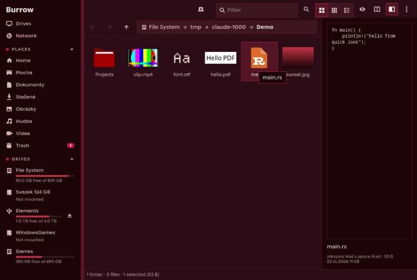
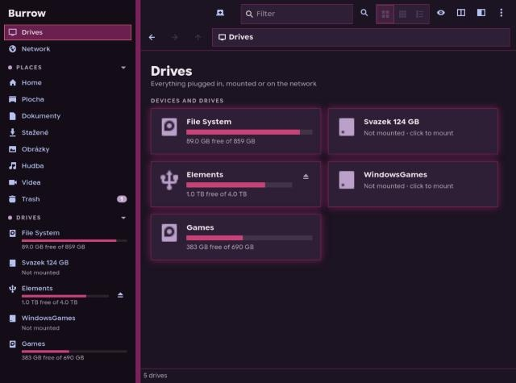

# Burrow

A file manager for Hyprland that looks like your rice: colours, corners, shadows and folder
icons come from the active hypr-rice, and it changes live when you switch.




Rust and plain GTK4 (no libadwaita), three dependencies, about 5 MB.

## What it does
- **Browse:** grid, compact and list views (remembered per folder), tabs, split view, live
  updates, quick even with 10,000 files in a folder
- **See:** thumbnails, preview pane (F4), quick look (Space)
- **Find:** type to filter, Ctrl+Shift+F to search subfolders
- **Sidebar:** your own sections with favorites, drives (usage bars) and servers; drag to
  rearrange, rename, recolour, change icons; drives remembered by UUID
- **Files:** copy/move/rename/batch rename/trash with progress, pause, clash dialog and
  Ctrl+Z; archives; shortcuts; New ▸; Open with; permissions
- **Network:** smb, sftp, ftp, nfs, phones; logins in the keyring; share a folder on the LAN
- **Yours:** every shortcut, vim keys, right-click actions, one readable config file

## Install
Needs Rust, GTK 4.18+ and a C compiler. For everything to work (Arch names):

```bash
sudo pacman -S gvfs gvfs-smb gvfs-nfs gvfs-mtp udisks2 libarchive 7zip bubblewrap ffmpegthumbnailer poppler avahi
```

```bash
./install.sh
```

`./install.sh --uninstall` removes it again. To make it the default file manager:

```bash
xdg-mime default world.puppygirl.Burrow.desktop inode/directory
```

To go back, use the old one's name, e.g. `xdg-mime default thunar.desktop inode/directory`.

## Hyprland
The app-id is `world.puppygirl.Burrow`. Suggested rules (Lua config):

```lua
hl.window_rule({match = {class = "^(world.puppygirl.Burrow)$" }, no_shadow = true})
hl.window_rule({match = {class = "^(world.puppygirl.Burrow)$" }, opacity = "1.0 0.95"})
hl.window_rule({match = {class = "^(world.puppygirl.Burrow)$", title = "^(Burrow settings|Properties|Quick look|Share .*|Connect to server)$" }, float = true, center = true})
```

The background is 94% opaque by default so blur shows through; change it in Settings.

## Configuration
`~/.config/burrow/config.toml`. Edit it or use Settings (Ctrl+,): both stay in sync, a file
with a mistake in it is never overwritten, and passwords never end up in it.

```toml
[appearance]
colors = "rice"          # follow the active rice, or always one: "gravity-falls"
radius = "rice"          # or a number of pixels
folder_color = "rice"    # "none", or a Papirus colour: red, pink, violet…

[keys]
split = ["<Ctrl><Alt>s"] # [] turns a shortcut off

[[action]]
name = "Resize to half"
command = "magick %f -resize 50% %d/small-%n"
types = ["image/*"]
```

Actions run the program directly, never through a shell, so odd file names can't do harm.
Placeholders: `%f` file, `%F` all files, `%d` folder, `%n` name, `%s` name without
extension, `%u`/`%U` addresses.

Without hypr-rice the built-in Lucid Blocks palette is used.

## Safety
Copies are written under a temporary name and renamed when complete; a move to another drive
deletes the original only after a clean copy; nothing is overwritten without asking; deleting
never follows links. Thumbnailers for video, PDF and fonts run in a sandbox without network
or access to your files.

## Development
`cargo test` runs the tests (`-- --ignored` adds the ones using the real trash and thumbnail
tools). `BURROW_APP_ID=world.puppygirl.BurrowTest` starts a second copy for testing.
Being the file chooser of other apps is researched in [docs/portal.md](docs/portal.md).

[Changelog](CHANGELOG.md) · [MIT license](LICENSE)
